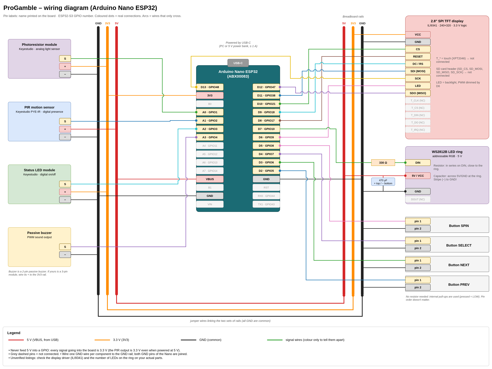

# ProGamble

A pocket casino that plays **European roulette with virtual points** (no real money). It runs on an
**Arduino Nano ESP32** programmed in MicroPython.

## Project goal

ProGamble is an interactive European roulette game:

- the device **wakes up when someone approaches** (PIR sensor),
- it **adjusts its screen brightness, LED brightness and sound volume to the room's light** (photoresistor),
- it **goes to sleep** when nobody is around.

The player places bets with **4 push buttons**. The wheel spins on the **TFT screen**, the **LED ring** and the
**buzzer**, and a **status LED** shows the device state.

## Team

- First Last (A): *to fill in*
- First Last (B): *to fill in*

GitHub repository: *to fill in*

## Hardware

| Qty | Component | Role |
|---|---|---|
| 1 | Arduino Nano ESP32 (ABX00083, ESP32-S3) | Main board |
| 1 | 2.8" SPI TFT display, ILI9341, 240×320 ([listing](https://www.aliexpress.com/item/32847628219.html)) | **New component**: game screen |
| 1 | WS2812B addressable RGB LED ring ([listing](https://www.aliexpress.com/item/1005005898995061.html)) | **New component**: wheel animation |
| 1 | Keyestudio photoresistor module (S, +, −) | **Analog** sensor: room light |
| 1 | Keyestudio PIR motion sensor (PYE-IR, S, +, −) | **Digital** sensor: presence |
| 1 | Passive buzzer | **PWM** output: sounds |
| 1 | Keyestudio LED module | **Digital** on/off output: status |
| 4 | 2-pin push buttons | Local controls (PREV, NEXT, SELECT, SPIN) |
| 1 | 330 Ω resistor | Protects the ring's data line (DIN) |
| 1 | ~470 µF electrolytic capacitor (≥ 10 V) | Absorbs the ring's power spikes |
| – | Breadboard and jumper wires | Solderless build |

> **Check your parts.** The AliExpress listings could not be checked automatically. This README assumes:
> - The display is the common red **2.8" ILI9341 SPI** module with 14 pins (VCC … T_IRQ) and an SD card
>   header. Check the chip name printed on the listing. If it is an **ST7789**, the wiring stays the same but
>   the driver changes.
> - The ring is a **WS2812B** (or a compatible SK6812 RGB). Count its LEDs (8, 12, 16 or 24) and set that
>   number in the code. It also affects the power budget below.

## Wiring diagram



The editable source is [`docs/wiring.drawio`](docs/wiring.drawio). Open it with drawio-desktop:

```sh
drawio docs/wiring.drawio
```

To export the picture again after editing:

```sh
drawio -x -f png -s 2 -b 10 -o docs/wiring.png docs/wiring.drawio
```

## Wiring (Nano ESP32)

D2, A0 and the other pin names are the labels **printed on the board**. In MicroPython you use the
**GPIO number**, which is listed next to each pin name. Check every pin against the official
[Nano ESP32 pinout](https://docs.arduino.cc/hardware/nano-esp32/).

### 2.8" TFT display (hardware SPI)

| Display pin | Board pin | GPIO | Note |
|---|---|---|---|
| VCC | 3V3 | – | The module has its own regulator. See "Power and precautions". |
| GND | GND | – | |
| CS | D10 | 21 | Chip select |
| RESET | D8 | 17 | |
| DC / RS | D9 | 18 | Data / command |
| SDI (MOSI) | D11 | 38 | SPI data to the screen |
| SCK | D13 | 48 | SPI clock. The board's built-in LED (also on D13) will flicker. That is normal. |
| LED | D6 | 9 | Backlight, dimmed with PWM. See the warning below. |
| SDO (MISO) | D12 | 47 | Optional. Only needed to read the screen ID (screen detection). |
| T_CLK, T_CS, T_DIN, T_DO, T_IRQ | – | – | Touch (XPT2046): **not connected** |
| SD_CS, SD_MOSI, SD_MISO, SD_SCK | – | – | SD card header: **not connected** |

### WS2812B LED ring

| Ring pin | Connects to | Note |
|---|---|---|
| DIN | D7 (GPIO 10) **through the 330 Ω resistor** | Put the resistor close to the ring. |
| 5V / VCC | 5 V rail (VBUS) | |
| GND | GND rail | |
| DOUT | – | Not connected. It only chains a second ring. |
| **470 µF capacitor** | between the ring's 5V and GND | The **stripe (−) goes to GND**. Place it right at the ring. |

### Sensors, buzzer, status LED and buttons

| Component | Module pin | Board pin | GPIO |
|---|---|---|---|
| Photoresistor | S / + / − | A0 / 3V3 / GND | 1 (ADC) |
| PIR sensor | S / + / − | A1 / VBUS (5 V) / GND | 2 |
| Status LED | S / + / − | A2 / 3V3 / GND | 3 |
| Passive buzzer | S (+) / − | A3 / GND | 4 (PWM) |
| Button PREV | pin 1 / pin 2 | D2 / GND | 5 |
| Button NEXT | pin 1 / pin 2 | D3 / GND | 6 |
| Button SELECT | pin 1 / pin 2 | D4 / GND | 7 |
| Button SPIN | pin 1 / pin 2 | D5 / GND | 8 |

- **Buttons:** each button connects to its pin on one side and to GND on the other. The code turns on the
  ESP32's **internal pull-ups** (`Pin.PULL_UP`), so a pressed button reads `0` and no external resistor is
  needed. The "+/−" marks on a plain 2-pin push button don't matter.
- **Status LED:** some Keyestudio LED modules leave the `+` pin unused. Wiring it to 3V3 is harmless either way.
- **Buzzer:** if yours is a 3-pin buzzer module, wire its `+` to 3V3.
- **All GNDs are connected together** through the GND rail of the breadboard.

### Pin summary (MicroPython `config.py`)

```python
# Arduino Nano ESP32: printed label -> ESP32-S3 GPIO
PIN_TFT_SCK    = 48  # D13
PIN_TFT_MOSI   = 38  # D11
PIN_TFT_MISO   = 47  # D12 (optional)
PIN_TFT_CS     = 21  # D10
PIN_TFT_DC     = 18  # D9
PIN_TFT_RST    = 17  # D8
PIN_TFT_BL     = 9   # D6 (PWM backlight), None if LED is wired to 3V3

PIN_RING       = 10  # D7 -> 330 Ω -> ring DIN
PIN_BTN_PREV   = 5   # D2
PIN_BTN_NEXT   = 6   # D3
PIN_BTN_SELECT = 7   # D4
PIN_BTN_SPIN   = 8   # D5

PIN_LIGHT      = 1   # A0 photoresistor (ADC1)
PIN_PIR        = 2   # A1 PIR
PIN_STATUS_LED = 3   # A2
PIN_BUZZER     = 4   # A3 (PWM)
```

Every analog input is on **ADC1** (A0–A3), so it keeps working when Wi-Fi is on.

## Power and precautions

- **Power source:** USB-C, from a computer or a 5 V power bank of at least 1 A. The `VBUS` pin gives that 5 V
  when the board runs on USB. **Measure about 5 V between VBUS and GND with a multimeter before you plug in
  the ring.**
- **LED ring current:** a WS2812B LED can draw up to ~60 mA at full white, so 16 LEDs ≈ 1 A and
  24 LEDs ≈ 1.4 A. That is more than a computer USB port supplies. The code **caps the ring brightness
  around 35 %** (about 350 mA for 16 LEDs). The 470 µF capacitor goes right at the ring, between 5V and GND,
  with the stripe (−) on GND.
- **Ring data level:** the ESP32 sends 3.3 V data to a ring powered at 5 V. This normally works with a
  **short** data wire and the 330 Ω resistor. If the ring flickers or shows random colours, shorten the wire
  or add a level shifter (74AHCT125).
- **Display:**
  - The logic is **3.3 V only**, which matches the ESP32.
  - On the red ILI9341 modules, `VCC` goes through an onboard 3.3 V regulator. Most ESP32 builds power it from
    3V3. If the screen is dim or unstable, move `VCC` to 5 V, but only if the **J1 jumper is open**. J1
    bypasses the regulator.
  - The `LED` pin usually drives the backlight through a transistor, so PWM from D6 is safe. If your module
    has **no** transistor there, connect `LED` to 3V3 and set `PIN_TFT_BL = None`.
- **PIR:**
  - Powered from 5 V, but its output is about 3.3 V, so it is safe for the ESP32. **Measure S before
    connecting it.**
  - It needs about 30 s to warm up after power-on.
  - The two potentiometers on the back set the sensitivity and the hold time.
- **Photoresistor:** power it from **3V3, never 5 V**. Its output must stay under 3.3 V.
- **No 5 V signal must ever reach a GPIO pin.**

## Installation and running

1. Flash MicroPython for the Arduino Nano ESP32 onto the board.
2. Copy the project's `.py` files to the board's root, for example with `mpremote cp *.py :`.
3. Reset the board. `main.py` starts by itself.
4. **Light calibration:** run the calibration script, then cover the sensor and shine a light on it. Copy the
   dark and bright readings into `config.py`.

If the screen is upside down or the colours are swapped, change the display's MADCTL (rotation) value in
`config.py`.

## How to play

- **PREV / NEXT:** change the selected option (chip or bet). Hold the button to scroll fast.
- **SELECT:** switch between the CHIP row (10 / 25 / 50 / 100) and the BET row (red, black, green, numbers 0–36).
- **SPIN:** spin the wheel. **Hold SPIN for 1.5 s** to start a new game (500 points).

Rules (European roulette, 37 pockets):

| Bet | Payout |
|---|---|
| Red or black | ×2 |
| A single number, or green (0) | ×36 |

- When 0 comes up, red and black bets lose.
- The bet is taken from the balance when the wheel is spun.
- A bet larger than the balance is refused.

## System states

`BOOT → BET ⇄ SPIN → RESULT → BET`, plus:

| State | When |
|---|---|
| `SLEEP` | No presence and no button press for 60 s |
| `GAMEOVER` | Balance under 10 points |
| `ERROR` | Safe mode after a fault |

| Output | Behaviour |
|---|---|
| Screen | Dims during SLEEP |
| Ring and buzzer | Change with the state and the result |
| Status LED | Lights up for 3 s after a win |

## Error handling

| Situation | Detection | Reaction |
|---|---|---|
| Photoresistor shorted or unplugged | Reading stuck at the minimum or maximum for 3 s | `!LIGHT` on screen, fallback brightness of 70 %, recovers on its own |
| PIR stuck high | Signal high for 10 min with no button press | `!PIR` on screen, PIR ignored (the buttons still wake the device) |
| Screen missing or crashed | ILI9341 ID read (needs MISO) or an exception | ERROR mode with a red ring, LED and beeps, retried every 5 s or on SPIN |
| Unexpected error during a spin | `try/except` in the main loop | Bet refunded, back to a safe state, no crash |
| Bet larger than the balance | Balance check | "NOT ENOUGH POINTS" message and a beep |
| Out of points | Balance < 10 | "GAME OVER". Hold SPIN to restart. |

Everything is **non-blocking**, using `time.ticks_ms()` and `time.ticks_diff()`.

## Known limitations

- An **unplugged** photoresistor signal wire leaves the input floating and can't always be detected. A short
  circuit can.
- An unplugged PIR reads 0, so it looks like "nobody is here". The buttons still wake the device.
- Screen detection needs the MISO wire (D12). Without it, turn the ID check off in `config.py`.
- The touch panel and SD card slot of the display are not used.
